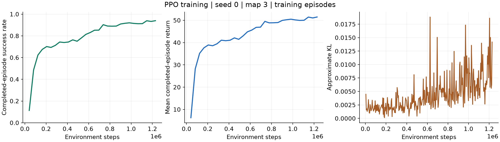
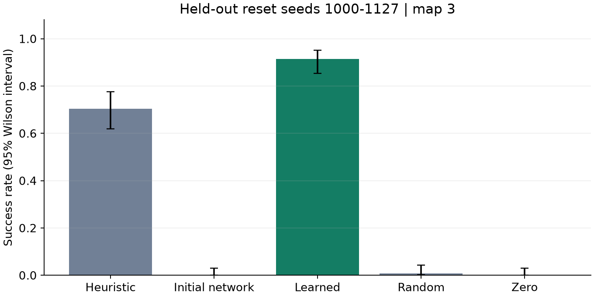

# Assignment 2: reinforcement learning

**Author:** Nikita Shankin  
**Typed signature:** Nikita Shankin  
**Date:** November 20, 2026  
**Status:** Includes the author's personal reflection.

## Objective and experimental setup

The task is to reach the destination without colliding, using the continuous acceleration and steering actions from Assignment 1. `src/algorithms/ppo.py` implements PPO directly with JAX and Optax. There is no imitation-learning stage, expert-action dataset, or hand-coded steering added to the learned action. The waypoint controller in `evaluate.py` is a separate baseline.

The main experiment trains on map 3, the arena described in [Assignment 1](assignment1.md), with randomized starts, headings, and moving-obstacle phase. Static obstacle positions and the goal stay fixed. Each episode has at most 240 actions, equivalent to 24 s of simulated time. The discount is per action, not per physics substep. Three independent training seeds (0, 1, and 2) use the same hyperparameters. Seed 0 is the primary checkpoint and video; seeds 1 and 2 check variability.

Evaluation uses 128 reset seeds, 1000 through 1127, independently from the evolving training PRNG stream seeded with 0. This is a held-out reset test on the same map distribution; it does not test unseen maps or unseen static layouts. The checkpoint is selected as the final update, not by maximizing performance on these evaluation seeds.

## Policy, critic, and PPO

The actor and critic are separate MLPs. Each has two 64-unit tanh hidden layers. Inputs are the normalized 24-value observation. The actor produces two Gaussian means and learns a state-independent two-dimensional log standard deviation. A sampled Gaussian latent is passed through `tanh` to obtain actions in `[-1,1]`. Evaluation uses `tanh(mean)` without sampling. The critic produces a scalar estimate of discounted return.

The PPO ratio is `rho=exp(log pi_new(z|s)-log pi_old(z|s))` for the stored latent `z`. Both old and new distributions use the same tanh transformation, so its change-of-variable Jacobian cancels in the ratio. Computing the ratio from stored latents also avoids an unstable inverse tanh near the action bounds. Entropy regularization uses the latent Gaussian entropy; this is an approximation to transformed-action entropy.

The clipped policy objective is:

```text
L_policy = -mean(min(rho*A, clip(rho, 0.8, 1.2)*A))
```

The critic uses a clipped squared-error objective with the same 0.2 clipping width. The total minimized loss is `L_policy + 0.5*L_value - 0.001*H_latent`. Gradients of the loss are stopped at collected rollout targets implicitly by computing them outside the differentiated loss. Advantage normalization uses the entire rollout batch.

The value target comes from generalized advantage estimation (GAE):

```text
delta_t = reward_t + gamma*(1-terminated_t)*V(next_observation_t) - V(observation_t)
A_t = delta_t + gamma*lambda*(1-done_t)*A_(t+1)
target_t = A_t + V(observation_t)
```

Here `terminated` includes success and collision. `done` also includes time-limit truncation. A time limit bootstraps from the actual final observation, but the recursion stops before crossing into the newly reset episode. True terminal transitions do not bootstrap. The rollout code computes the final-state value before selecting reset observations. This distinction is covered by a numerical unit test.

## Hyperparameters

| Setting | Value |
| --- | ---: |
| Training PRNG seed | 0 |
| Parallel environments | 32 |
| Rollout length | 128 actions |
| Transitions per update | 4096 |
| Updates | 300 |
| Total transitions | 1,228,800 |
| PPO epochs per rollout | 4 |
| Minibatch size | 512 |
| Optimizer | Adam, epsilon `1e-5` |
| Learning rate | `3e-4`, constant |
| Global gradient norm limit | 0.5 |
| Discount gamma | 0.99 |
| GAE lambda | 0.95 |
| Policy/value clip width | 0.2 |
| Initial log standard deviation | -0.5 |

Actor output weights use orthogonal initialization with gain 0.01; critic output gain is 1 and hidden-layer gain is sqrt(2). The learned log standard deviation is clamped to `[-5,1]` when used by the policy. All observations, network weights, and dynamics use float32.

## Computational optimizations

`jax.vmap` batches independent environments and resets. `jax.lax.scan` runs the entire rollout, reverse GAE pass, PPO epochs, and minibatches without Python timestep loops. One JIT-compiled update contains collection and optimization. Adam and global gradient clipping run on JAX arrays through Optax. Network weights, environment states, and optimizer state remain on the selected device across updates.

Fixed array shapes and immutable, scalar environment parameters allow the compiled executable to be reused. The planner runs at initialization and its route is reused at reset. Rendering, JSON logging, and checkpoint writing remain outside the training graph; diagnostic arrays are transferred to the host once per update. Evaluation is separately vectorized and compiled. No GPU is required for this small experiment.

The benchmark in `src/benchmark.py` measures the first call separately and synchronizes all results with `jax.block_until_ready`. It compares an environment rollout compiled as a scan against the same vectorized environment dispatched from a Python timestep loop. It does not measure PPO throughput and should not be interpreted as a GPU-versus-CPU comparison. Exact measurements are in [benchmark.json](../results/benchmark.json).

## Measured results

See [the experiment results](results.md) for the measured held-out results, runtime, and benchmark figures. Across the three training seeds, mean held-out success is 90.89% with a sample standard deviation of 2.39 percentage points. Seed 0 reaches the goal in 117/128 episodes (91.41%); the waypoint baseline reaches it in 90/128 (70.31%). The underlying JSON files, initial checkpoint, final checkpoint, and runtime metadata are retained in `results/ppo_seed0/`, with repeated runs in `ppo_seed1/` and `ppo_seed2/`. The curves below are generated from actual training logs; training success rates aggregate completed episodes in windows of ten updates and should not be confused with independent evaluation episodes.





The learned-policy demonstration is [learned.mp4](../results/learned.mp4), recorded with reset seed 0. Its exact episode result is in [learned.json](../results/learned.json). A video illustrates one trajectory and does not replace the aggregate evaluation.

## Reproduction and checkpoint

Follow the environment setup in the README, then run:

```bash
python -m algorithms.ppo --seed 0 --updates 300 --output results/ppo_seed0
python -m evaluate --checkpoint results/ppo_seed0/policy.npz --episodes 128 --seed 1000 --output results/ppo_seed0/eval_learned.json
python -m evaluate --checkpoint results/ppo_seed0/initial.npz --episodes 128 --seed 1000 --output results/ppo_seed0/eval_initial.json
python -m evaluate --policy random --episodes 128 --seed 1000 --output results/ppo_seed0/eval_random.json
python -m evaluate --policy heuristic --episodes 128 --seed 1000 --output results/ppo_seed0/eval_heuristic.json
python -m evaluate --policy zero --episodes 128 --seed 1000 --output results/ppo_seed0/eval_zero.json
python -m demo --checkpoint results/ppo_seed0/policy.npz --policy learned --seed 0 --output results/learned.mp4
python -m benchmark
python scripts/summarize_results.py
```

Repeat training with `--seed 1 --output results/ppo_seed1` and `--seed 2 --output results/ppo_seed2`, keeping 300 updates and all other options unchanged. Evaluate each resulting checkpoint with reset seed 1000 and 128 episodes, saving to that run's `eval_learned.json`. Regenerate the results appendix after all three evaluations are present.

The inference checkpoint is [policy.npz](../results/ppo_seed0/policy.npz) with [policy.json](../results/ppo_seed0/policy.json). It uses named numeric arrays without pickle. The JSON sidecar records architecture, training hyperparameters, and environment parameters. Evaluation restores these environment settings. This snapshot supports inference; it does not include Adam state, environment rollout state, or PRNG state for exact training resumption. A fresh training run is reproducible from its seed and dependencies, subject to platform-dependent numerical differences.

## Limitations and next experiments

The experiment uses three training seeds, which provide only a small estimate of training variability. Wilson intervals in the comparison figure quantify variation across sampled reset episodes conditional on the seed-0 checkpoint, not uncertainty across training runs. Further experiments should add more training seeds and evaluate unseen static layouts, the supplied maps, tighter spaces, and different hazard speeds. The current experiment should not be described as a general solution to self-driving or maze navigation.

The actor has no memory, so moving-obstacle velocity is hidden. The fixed map and goal can permit memorization. The planner supplies privileged route information. Low-speed kinematic dynamics omit lateral tyre slip and the policy need not stop at the destination. Reward weights were chosen manually and no reward ablation has been run. Evaluation actions are deterministic, whereas training actions are sampled.

## Engineering observations

Implementation checks focus on errors that can silently invalidate RL: a return leaking across reset, a timeout treated as an absorbing physical terminal, a mismatch between a bounded action and its probability calculation, and repeating a success bonus after an episode ends. The GAE numerical test, stored Gaussian latents, explicit terminal flags, absorbing-state tests, and checkpoint roundtrip address these issues. A short training test confirms actor weights change and losses stay finite.

## Personal Reflection 2

The main difficulty for me in reinforcement learning was connecting theoretical concepts with their practical implementation. I also understood actor–critic as two parts: the actor chooses actions, and the critic evaluates them. In this assignment, PPO uses these ideas to improve the policy. Looking at the training process step by step makes it easier to understand: collect experiences, calculate advantages, update the networks, and repeat.

The most interesting result is that the trained agent achieved a 91.41% success rate, compared with 70.31% for the heuristic policy. This shows that the agent learned to navigate the tested environment better than the baseline. However, it does not mean that it will work equally well on completely different maps.

Another important part is handling episode termination correctly, especially the difference between reaching a terminal state and a time limit. Mistakes here can affect the advantage calculation and training.

If I continued the experiments, I would test the model on unseen maps and with different moving obstacles. I think this would help understand whether the agent really learned a useful navigation strategy or mainly adapted to the training environment.

## Sources and attribution

- Schulman, Wolski, Dhariwal, Radford, and Klimov (2017), [Proximal Policy Optimization Algorithms](https://arxiv.org/abs/1707.06347), for PPO's clipped policy objective.
- Schulman, Moritz, Levine, Jordan, and Abbeel (2015), [High-Dimensional Continuous Control Using Generalized Advantage Estimation](https://arxiv.org/abs/1506.02438), for GAE.
- [JAX JIT documentation](https://docs.jax.dev/en/latest/jit-compilation.html), for compilation and static-shape execution.
- [InnoRL starter repository](https://github.com/InnoRL/IAEML-assignment), for the base interface, original maps, ray geometry, and coordinate helpers.
- The brief also links [horoiwa/rl-with-flax-nnx](https://github.com/horoiwa/rl-with-flax-nnx). It was inspected as a reference; the PPO implementation here was written separately and does not copy that repository's trainer.
